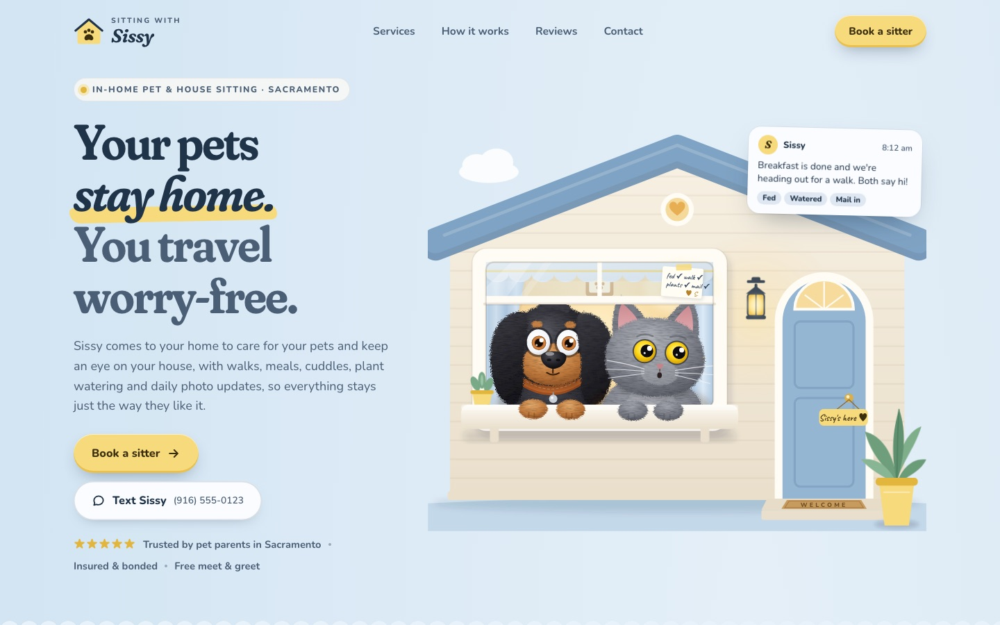

# Sitting with Sissy

A warm, playful landing page for **Sitting with Sissy**, an in-home house sitting and pet care service in Sacramento, California.

**Live demo:** [sitting-with-sissy.vercel.app](https://sitting-with-sissy.vercel.app)



## Highlights

- **Interactive hero.** A hand-built SVG house with a puppy and a cat whose heads turn and eyes follow the cursor. Each pet has its own idle personality (blinks, ear twitches, head tilts), wanders on its own on touch devices, and reacts to taps with little hearts. The puppy waves a paw as you scroll away.
- **Booking request flow.** A six-step, Airbnb-style form (dates, service, extras, home details, pets, contact) with a live price summary, validation, a dynamic pets list and a confirmation screen. It posts to any form endpoint such as Formspree.
- **Scroll storytelling.** A "typical day" timeline that draws itself as you scroll, with text-message updates popping in, plus a checklist that ticks itself off.
- **Mobile first.** Tested from 320px phones to wide desktops, with a sticky "Book a sitter" button on phones.
- **Accessible and considerate.** Semantic HTML, labeled form controls, keyboard focus states, and a `prefers-reduced-motion` mode that turns animation off.
- **Zero dependencies.** One HTML file with hand-written CSS and vanilla JavaScript. No framework and no build tools beyond a tiny Python packaging script.

## Built with

HTML · CSS (custom properties, grid, `:has()`) · vanilla JavaScript · inline SVG with filter-based fur shading · IntersectionObserver · Google Fonts (Fraunces, Nunito, Caveat) · Vercel

## Project structure

```
sitting-with-sissy.html   the page you edit (styles, markup and scripts)
img/                      photos used on the page
build-site.py             packages the page into a hostable site/ folder
site/                     generated site that Vercel serves
vercel.json               tells Vercel to serve site/
docs/                     README images
```

## Run locally

```bash
python3 build-site.py
python3 -m http.server 8000 --directory site
```

Then open http://localhost:8000.

## Deploy

Pushing to `main` deploys automatically once the repo is connected to Vercel. To deploy by hand:

```bash
python3 build-site.py
npx vercel@latest deploy --prod --yes
```

## Configuration

Business details live in the `CONFIG` object in the second `<script>` block of `sitting-with-sissy.html`: phone number, email, social links, prices and the booking form endpoint. Set `endpoint` to a Formspree (or similar) URL to receive booking requests by email.

> The phone number, reviews, prices, service areas and cancellation policy are placeholders for the client to replace.

## Credits

Design and development by [@lmntrixzil](https://github.com/lmntrixzil). Photos from [Unsplash](https://unsplash.com).
